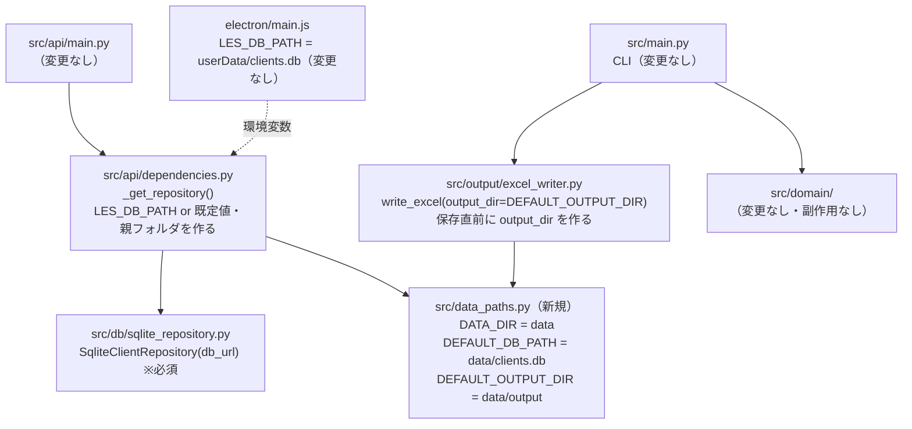
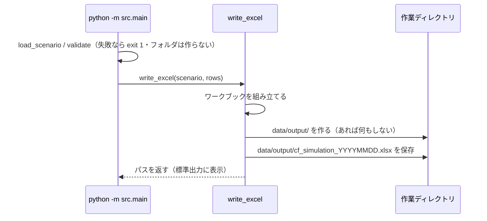
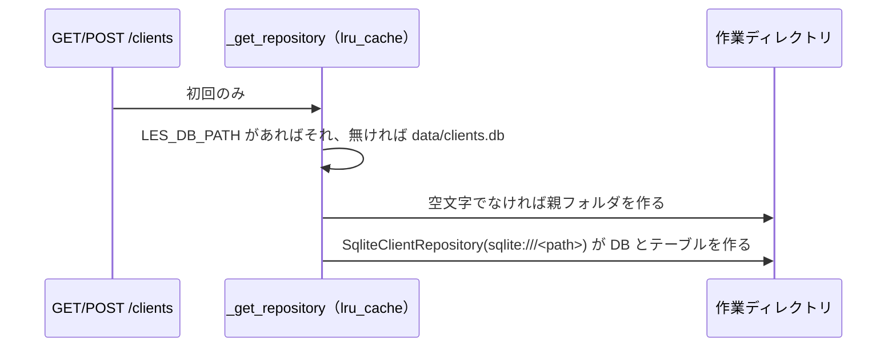

# 設計書: 顧客データの置き場所を `data/` にまとめる

作成日: 2026-10-20（architect）
対象タスク: `tasks/todo.md`「実装計画: 開発基盤の安全設定」タスク0.5
振る舞い仕様（正本）: `docs/design/test_spec_data_directory.md`

---

## 目的

顧客 DB と出力の Excel の既定の置き場所を、リポジトリ直下から `data/` の下（`data/clients.db`・`data/output/`）に移す。フォルダが無ければ作る。実データのシナリオの置き場 `data/scenarios/` と合わせ、顧客データを `data/` 1か所にまとめる（`CLAUDE.md` コア原則「構成は直感的に」・`docs/rules/00_workflow.md`「配置の原則」）。

計算モデル（`src/domain/`）・API の応答・Excel の中身・ファイル名は変えない。FP 確認事項は無い。

---

## 設計の要点

### 1. 既定のパスは `src/data_paths.py` 1か所に置く

```python
# src/data_paths.py
"""顧客データの既定の置き場所。

相対パスはプロセスの作業ディレクトリ基準（コマンドはリポジトリ直下で実行する前提）。
data/ の下は git に入れない（.gitignore）。
"""
from pathlib import Path

DATA_DIR = Path("data")
DEFAULT_DB_PATH = DATA_DIR / "clients.db"
DEFAULT_OUTPUT_DIR = DATA_DIR / "output"
```

- **なぜ `dependencies.py` ではなく新しいモジュールか**（運営者の決定3「置き場所が別の方が直感的なら提案してよい」への提案）:
  - 既定値は DB だけでなく Excel の出力先もある。DB の既定値を `src/api/dependencies.py` に置くと、Excel の出力先（`src/output/`）は `data/` を別に書くか、出力層が API 層を import することになる。前者は `data/` の定義が2か所に割れ、後者は依存の向きが逆になる（出力層は API 層を知らない）
  - 「顧客データの置き場所」という同じ種類のものを、名前で中身が分かる1ファイルにまとめる。`.gitignore`・Read の deny・guard の `data/` と対になる場所を、コードの中でも1か所にする
  - 中身は定数3つだけで、関数も副作用も持たない（過剰な抽象化をしない）
- `data/scenarios/` の定数は**置かない**。コードは使わない（運営者の決定4: README に `mkdir -p data/scenarios` と書き、コードでは作らない）
- 相対パスのまま持つ。作業ディレクトリ基準（運営者の決定1）。絶対パスに解決しない

### 2. DB の既定値は `dependencies.py` だけが使う。Repository は `db_url` 必須にする

運営者の決定3。既定値を持つのは「アプリの組み立て」をする `_get_repository()` だけにし、`SqliteClientRepository` は渡された URL を使うだけにする。

```python
# src/db/sqlite_repository.py（変更）
class SqliteClientRepository(ClientRepository):
    def __init__(self, db_url: str) -> None:   # 既定値 "sqlite:///clients.db" を削除
        ...  # 中身は変えない
```

```python
# src/api/dependencies.py（変更）
from pathlib import Path
from src.data_paths import DEFAULT_DB_PATH

@lru_cache(maxsize=1)
def _get_repository() -> SqliteClientRepository:
    """アプリケーション全体で1つの Repository インスタンスを共有する。"""
    db_path = os.environ.get("LES_DB_PATH", str(DEFAULT_DB_PATH))
    if db_path:
        # SQLite は親フォルダが無いと開けない。data/ は git に入らないので clone 直後は無い。
        # LES_DB_PATH を明示したときも同じ扱いにする（運営者の決定2）
        Path(db_path).parent.mkdir(parents=True, exist_ok=True)
    return SqliteClientRepository(db_url=f"sqlite:///{db_path}")
```

- **`if db_path:` は仕様 A6 を変えないため**。`LES_DB_PATH=""` のとき、今は `sqlite:///`（メモリ DB）になる。`Path("")` は `Path(".")` になるので、空文字を `Path` に通して URL を作ると `sqlite:///.` に変わってしまう。URL は今までどおり文字列 `db_path` から作り、フォルダ作成だけを空文字のとき飛ばす
- 既定値を `os.environ.get` の第2引数に `str(...)` で渡す（Windows では `data\clients.db` になるが、SQLAlchemy の SQLite URL はどちらの区切りも受け付ける）
- `lru_cache(maxsize=1)` は**残す**。アプリ全体で1つの Repository を共有する理由は変わらない。フォルダ作成は Repository を最初に作るとき1回だけ走る（`/clients` を初めて呼んだとき）。テストでは前後で `_get_repository.cache_clear()` を呼ぶ（後述）
- フォルダ作成をここに置く理由: 親フォルダを作るのは「どの場所を使うか決めた側」の責任。Repository に置くと、URL を解析してファイルパスを取り出す処理（`:memory:`・空 URL の除外）が DB 層に増える。`dependencies.py` はパスを文字列で持っているので解析が要らない

**`SqliteClientRepository(` を引数なしで呼んでいる所（grep 済み・2026-10-20）**: 無い。呼び出しは `src/api/dependencies.py`（URL を渡す）・`tests/db/test_sqlite_repository.py`・`tests/api/test_clients.py`（どちらも `:memory:` を渡す）の3か所だけ。`api-server.spec`（PyInstaller）は `src.db.sqlite_repository` を hiddenimports に持つだけで呼び出さない。`src/data_paths.py` は `dependencies.py` から静的に import されるので hiddenimports への追加は不要

### 3. Excel の既定の出力先は `write_excel()` の既定値で持つ。フォルダは書く直前に作る

```python
# src/output/excel_writer.py（変更）
from src.data_paths import DEFAULT_OUTPUT_DIR

def write_excel(
    scenario: Scenario,
    rows: list[CashFlowRow],
    output_dir: str | Path = DEFAULT_OUTPUT_DIR,   # "." から変更
    fp_comment: str = "",
    fp_name: str = "",
) -> Path:
    ...
    output_dir = Path(output_dir)
    output_dir.mkdir(parents=True, exist_ok=True)   # wb.save の直前
    output_path = output_dir / filename
    wb.save(output_path)
```

- 既定値を `write_excel()` に残すのは、仕様 C1（`output_dir` を渡さなければ `data/output/`）を関数の振る舞いとして持たせるため。`src/main.py` は `write_excel(scenario, rows)` のままで C7・C8 を満たす → **`src/main.py` は変更しない**
- 出力層はもともとファイルを書く I/O の層なので、フォルダ作成という副作用を置いてよい。ドメイン層（`src/domain/`）には何も足さない
- `mkdir(parents=True, exist_ok=True)` は既にあるフォルダ・中のファイルを変えない（C3）。`output_dir` が既存の**ファイル**なら `FileExistsError` になる（C5。黙って別の場所に書かない）
- フォルダ作成は `wb.save` の直前に置く（ワークブックを組み立てる前ではない）。`src/main.py` は読み込み・検証に失敗すると `write_excel` を呼ぶ前に `sys.exit(1)` するので、C9（失敗したら `data/output/` を作らない）はこの配置で満たせる
- 返り値は `Path(output_dir) / filename`。既定なら相対パス `data/output/cf_simulation_YYYYMMDD.xlsx`（Windows では区切りが `\`）。標準出力のメッセージもこのパスになる

### 4. 変わるシグネチャ

| 対象 | 今 | 変更後 |
|---|---|---|
| `SqliteClientRepository.__init__` | `(self, db_url: str = "sqlite:///clients.db")` | `(self, db_url: str)`（必須） |
| `write_excel` | `output_dir: str \| Path = "."` | `output_dir: str \| Path = DEFAULT_OUTPUT_DIR` |
| `_get_repository` / `get_client_repository` | 変わらない（中身だけ変わる） | — |
| `src.main.main` | 変わらない | — |

### 依存関係図



### データフロー





---

## 対象ファイル（層ごと）

| 層 | ファイル | 変更 |
|---|---|---|
| 共通（定数） | `src/data_paths.py` | **新規**。定数3つ |
| API（組み立て） | `src/api/dependencies.py` | 既定値を `DEFAULT_DB_PATH` に・親フォルダを作る |
| DB | `src/db/sqlite_repository.py` | `db_url` の既定値を削除（必須に）。docstring の「テスト時は〜」はそのまま |
| 出力 | `src/output/excel_writer.py` | `output_dir` の既定値を `DEFAULT_OUTPUT_DIR` に・保存直前にフォルダを作る・docstring の `output_dir` の説明に既定と「無ければ作る」を足す |
| CLI | `src/main.py` | 変更なし |
| ドメイン | `src/domain/` | 変更なし |
| テスト | `tests/api/test_dependencies.py`（新規）・`tests/db/test_sqlite_repository.py`（追記）・`tests/output/test_excel_writer.py`（追記）・`tests/test_main.py`（新規） | 下の「テスト設計」 |
| 設定 | `.gitignore` | `/data/` を足す（先頭の `/` で直下の `data/` だけにする。reviewer 2026-10-20: `data/` だと `src/data/` などのソースのフォルダまで除外されるため。「# 顧客データ（実データのシナリオ・DB・出力）」の見出しで。既存の `*.db`・`*.xlsx` は `data/` の外に残った分と Electron 用に残す） |
| 文書 | `README.md` | 「データの置き場所」の節を足す（仕様 F1〜F6。`mkdir -p data/scenarios` を含む） |
| 文書 | `docs/guides/setup-windows.md` | 5 節の手順3「フォルダ内に Excel ファイルが生成されます」→ `data\output` フォルダに生成される、に直す（運営者の決定6。手順2の `python src/main.py` はバックログのまま触らない） |
| 文書 | `docs/rules/00_workflow.md` | 構成図に `src/data_paths.py` を足す（「新しい置き場を作るときは構成図に足してから作る」）。構成図に無い `src/api/`・`src/db/`・`tests/api/`・`tests/db/` と、`tests/test_main.py` も足す（実在するのに図に無い・同じ原因）。「配置の原則」の「移行中」の行を消す |
| 文書 | `docs/rules/04_testing.md` | 「ファイル命名」に `tests/api/`・`tests/db/`・`tests/test_main.py`（`src/main.py` のテスト。`tests/` が `src/` の構成を写すので直下に置く）を足す |
| 文書 | `docs/diagrams/system.mmd` | Excel のノードのパスを `data/output/cf_simulation_YYYYMMDD.xlsx` に直す |
| 計画 | `tasks/todo.md` | 「前提として分かっていること」の `clients.db` の行を新しい既定値に直す（仕様の engineer へのノートのとおり） |

直さないもの: 過去の設計書 `docs/design/ep4.4_design.md`・`ep4.5_client_persistence_design.md`・`ep4.5_electron_design.md`（当時の記録）。

---

## テスト設計

### 共通の前提（fixture）

- 既定値を確かめるテストは、すべて `monkeypatch.chdir(tmp_path)` で作業ディレクトリを一時フォルダに移す。リポジトリ直下に `data/`・`clients.db`・xlsx を作らない（D5）
- `LES_DB_PATH` は `monkeypatch.delenv("LES_DB_PATH", raising=False)` / `monkeypatch.setenv` で制御する
- `tests/api/test_dependencies.py` には autouse の fixture を置き、**テストの前後で `_get_repository.cache_clear()`** を呼ぶ。後ろでも呼ぶのは、`tmp_path` を指す Repository がキャッシュに残り、後で走る別のテストが `/clients` を差し替えなしで呼んだときに使われるのを防ぐため
- 期待するパスは `Path("data") / "output" / f"cf_simulation_{datetime.now():%Y%m%d}.xlsx"` のように `Path` で組み立てる（Windows の区切りでも落ちない）。日付またぎで落ちないよう、期待値は呼び出しの直後に作る
- 実データ・直下の `clients.db`・xlsx は使わない。CLI のシナリオは直下の `scenario.yaml` を `tmp_path` に写して使う（コピー元は `Path(__file__)` から辿る。`chdir` 後は相対パスで見えないため、`chdir` の前にコピーする）

### 仕様とテストの対応

#### `tests/api/test_dependencies.py`（新規）`TestDefaultDbPath`

| テストメソッド | 仕様 | 確かめること |
|---|---|---|
| `test_LES_DB_PATH未設定なら_data配下のclients_dbを使う` | A1 | `tmp_path/data/clients.db` ができ、`tmp_path/clients.db` は無い |
| `test_dataフォルダが無くても作って起動できる` | A2 | `data/` が無い状態から例外なし・`data/` ができる |
| `test_dataフォルダの既存ファイルを消さない` | A3 | 先に置いた `data/scenarios/x.yaml` の中身が実行後も同じ |
| `test_LES_DB_PATHを明示したらその場所を使う` | A4 | `tmp_path/userdata/clients.db`（`userdata/` は先に作る）ができ、`tmp_path/data` はできない |
| `test_LES_DB_PATHの親フォルダが無ければ作る` | A5 | `tmp_path/a/b/clients.db` を指定 → `a/b/` とファイルができ、`data/` はできない |
| `test_LES_DB_PATHが空文字ならフォルダを作らない` | A6（回帰防止） | 例外なし・`tmp_path` に何も増えない（メモリ DB のまま） |

確かめ方は `_get_repository()` を直接呼ぶ。`list_all()` を1回呼んで接続できることも見る。

#### `tests/db/test_sqlite_repository.py`（追記）`TestDbUrlRequired`

| テストメソッド | 仕様 | 確かめること |
|---|---|---|
| `test_db_urlを渡さないとTypeError` | B1 | `SqliteClientRepository()` が `TypeError`。既定値が2か所目として戻ってこないことの回帰防止 |
| `test_ファイルのURLを明示したらその場所に作る` | B3 | `sqlite:///{tmp_path}/x.db` → そのファイルができる |

B2（`:memory:`）は既存のテスト全体で担保されている。

#### `tests/output/test_excel_writer.py`（追記）`TestDefaultOutputDir`

| テストメソッド | 仕様 | 確かめること |
|---|---|---|
| `test_出力先を渡さなければdata_outputに書く` | C1 | 返り値が `Path("data")/"output"/<名前>`・ファイルがある・`tmp_path` 直下に xlsx が無い |
| `test_出力先フォルダが無ければ親ごと作る` | C2 | `data/` が無い状態から例外なし |
| `test_存在しない出力先を明示したら作って書く` | C4 | `output_dir=tmp_path/"a"/"b"` → ファイルがあり、`tmp_path/data` はできない |
| `test_出力先にファイルを渡したらエラー` | C5 | 既存ファイルを `output_dir` に渡すと例外（型は `OSError` の仲間であればよい。文言は問わない） |
| `test_同じ日に2回出力すると上書きする` | C6 | 2回目も同じパスを返し、ファイルは1つ |

C3（既存のフォルダを明示）は既存のテスト（全部 `output_dir=tmp_path`）で担保される。テスト用のシナリオ・rows は既存の fixture を使う。

#### `tests/test_main.py`（新規）`TestMainOutput`

置き場所: `src/main.py` は `src/` 直下のファイルなので、`tests/` 直下に `test_main.py` として置く（`tests/` は `src/` の構成を写す。`tests/cli/` のような新しいフォルダは `src/cli/` が無いので作らない）。`tests/__init__.py` は既にある。

| テストメソッド | 仕様 | 確かめること |
|---|---|---|
| `test_シナリオを渡すとdata_outputにExcelができる` | C7 | `sys.argv` を `["src.main", "data/scenarios/s.yaml"]` にし（`tmp_path/data/scenarios/` に写したサンプル）、`main()` が正常終了・`data/output/` にファイル・`capsys` の標準出力が `Excelファイルを生成しました: <Path("data")/"output"/名前>` |
| `test_入力の場所に関係なく出力先はdata_output` | C8 | サンプルを `tmp_path/scenario.yaml` に写して渡す → 出力は `data/output/` |
| `test_読み込みに失敗したら出力フォルダを作らない` | C9 | 存在しない YAML → `SystemExit` の `code == 1`・`tmp_path/data` が無い |

`sys.argv` は `monkeypatch.setattr(sys, "argv", [...])` で差し替える。サブプロセスは使わない（速く、`src` の解決に作業ディレクトリが要らない）。

#### テストにしないもの

| 仕様 | 確かめ方 |
|---|---|
| D1・D2・D4 | 既存のテストがそのまま通ること（`.venv/bin/python -m pytest`）・`git diff --stat src/domain/` が空 |
| D3 | 変更しない（PDF のコードに触れない）ことを diff で確認 |
| D5 | 全テストの前後で `git status --short --ignored` を比べ、直下に `data/`・`clients.db`・xlsx が増えていないこと（直下の既存ファイルは運営者が移すまで残っているので「増えていない」で見る） |
| E1〜E4 | engineer が `git check-ignore -v` と `git ls-files` を実行し、結果を reviewer に見せる（pytest にしない） |
| F1〜F6・G1 | reviewer が README・手引きを読んで確かめる |

---

## engineer へのノート

- Red の順: `tests/test_main.py`・`TestDefaultOutputDir`・`TestDefaultDbPath`・`TestDbUrlRequired` を書き、失敗を確認してから `src/data_paths.py` → `excel_writer.py` → `sqlite_repository.py` → `dependencies.py` の順で直す。A4（明示したらその場所）・A6・C3 は今の実装でも通る回帰防止のテストなので、Red で通ってしまってよい
- `Path(db_path)` を URL の組み立てに使わない（A6 が変わる。設計の要点2）
- `write_excel` の docstring と `SqliteClientRepository.__init__` の docstring を変更に合わせる。コメントは「なぜ」（SQLite は親フォルダが無いと開けない・`data/` は git に入らないので clone 直後は無い）を書く
- 直下の `clients.db`・`cf_simulation_*.xlsx` は開かない・動かさない・テストで参照しない。マージ前に運営者が `data/` に移す（運営者の決定5）。警告のコードは足さない
- `src/main.py`・`src/domain/`・`src/output/pdf_writer.py`・`electron/` には触れない
