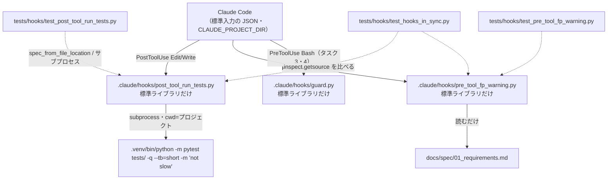

# 設計書: 編集フック（テスト実行・FP 未確認の警告）を `.claude/hooks/` のスクリプトに作り直す

作成日: 2026-10-22（architect）
最終更新: 2026-10-24（確認点7件を「運営者の決定」として反映）
対象タスク: `tasks/todo.md`「実装計画: 開発基盤の安全設定」タスク2
振る舞い仕様（正本）: `docs/design/test_spec_edit_hooks.md`（運営者の決定 2026-10-22 を含む）

---

## 目的

`.claude/settings.json` の2つのフックは、渡されない環境変数を見ていて動いておらず、結果も Claude に届かない。これを、標準入力の JSON を読んで `additionalContext` で返す Python スクリプト2つに作り直す。

- `src/` を Edit / Write した直後に `.venv` の pytest（`slow` を除く）が走り、結果の要約が Claude に届く
- `src/domain/` を Edit / Write する前に、要件定義書に `TODO: FPに確認` が残っていれば警告が届く（編集は止めない）
- どんな入力・環境でもフックが原因で作業が止まらない（fail-open）
- 設定にリポジトリの絶対パスを残さない

計算モデル・`src/`・要件定義書の中身には触れない。FP 確認事項は無い。

---

## 対象ファイル（層ごと）

| 層 | ファイル | 変更 |
|---|---|---|
| 開発基盤（フック） | `.claude/hooks/post_tool_run_tests.py` | **新規**。テスト実行フック（仕様 A・B・C・E） |
| 開発基盤（フック） | `.claude/hooks/pre_tool_fp_warning.py` | **新規**。FP 未確認の警告フック（仕様 A・B・D・E） |
| テスト | `tests/hooks/__init__.py` | **新規・空**（`tests/` は層ごとのパッケージ） |
| テスト | `tests/hooks/conftest.py` | **新規**。フックのスクリプトをファイルから読み込む fixture |
| テスト | `tests/hooks/test_post_tool_run_tests.py` | **新規** |
| テスト | `tests/hooks/test_pre_tool_fp_warning.py` | **新規** |
| テスト | `tests/hooks/test_hooks_in_sync.py` | **新規**。2ファイルに重複させた関数が同じであることを確かめる（設計の要点2。仕様に無い追加。運営者の決定1） |
| 文書 | `docs/rules/04_testing.md` | 「ファイル命名」に `tests/hooks/` を足す。`.claude/hooks/` のテストで、「`tests/` は `src/` を写す」の例外である旨を書く |
| 文書 | `docs/rules/00_workflow.md` | ディレクトリ構成図に `.claude/hooks/`（Claude Code のフック）と `tests/hooks/` を足す（「新しい置き場を作るときは、この構成図に足してから作る」）。最終更新日を変える |
| 設定 | `.claude/settings.json` | **タスク2では変えない**。タスク4で差し替える（設計の要点6に差し替え後の姿） |
| ドメイン・入力・出力・API・DB | `src/` 全体 | 変更なし |

---

## 設計の要点

### 1. 各スクリプトは「純粋な判定」と「入出力」を分ける。継ぎ目は `main()` の引数

両スクリプトとも、上から次の3段に分ける。

| 段 | 中身 | 副作用 |
|---|---|---|
| 純粋な関数 | 標準入力の文字列から `file_path` を取り出す・パスの判定・pytest の結果から文言を作る・上限で切る | 無し（ファイルシステムは `Path.resolve()` でリンクを解決するだけ） |
| `build_context(...)` | 上の関数を順に呼び、返す `additionalContext` の文字列か `None`（何も返さない）を決める | pytest の起動（差し替え可）・要件定義書を読む |
| `main(...)` | 標準入力を読む → `build_context` → JSON を1つ書く。全体を `except Exception` で包み、常に 0 を返す | 標準入出力 |

**テストから差し替える継ぎ目は、`main()` と `build_context()` の引数で渡す**（モジュールの属性を monkeypatch しなくても書ける形にする）。

| 継ぎ目 | 渡し方 | 本番の値 | テストで渡すもの |
|---|---|---|---|
| 標準入力 | `main(stdin=...)`（バイト列のストリーム） | `sys.stdin.buffer` | `io.BytesIO(b'...')`。B9 は `read()` で例外を出す BytesIO の派生 |
| 標準出力 | `main(stdout=...)`（バイト列のストリーム） | `sys.stdout.buffer` | `io.BytesIO()` を読み、`json.loads` する |
| 環境変数 | `main(environ=...)` / `build_context(environ=...)`（`Mapping[str, str]`） | `os.environ` | `{"CLAUDE_PROJECT_DIR": str(project)}` のような dict（`project` は `(tmp_path / "les").resolve()`）。B6 は空の dict、B7 は空文字 |
| pytest の実行 | `main(run=...)` / `build_context(run=...)`（`subprocess.run` と同じ呼び方の callable） | `subprocess.run` | 呼ばれた引数（args・cwd・stdin・timeout）を記録し、決めた `CompletedProcess` を返す偽物。C10 は `PermissionError`、C11 は `subprocess.TimeoutExpired` を投げる |
| 時間 | 定数 `TIMEOUT_SECONDS` を `run(..., timeout=TIMEOUT_SECONDS)` で渡す。フック自身は時計を読まない | 120 | 偽の `run` が受け取った `timeout` が `TIMEOUT_SECONDS` と等しいことを見る。時間切れは偽物が `TimeoutExpired` を投げて起こす（実際に待たない） |

`main()` の引数はすべて省略可能（`None` なら本番の値）。本番の値の取り出し（`sys.stdin.buffer` など）も `try` の内側で行う（標準入力が閉じている等でも exit 0 にするため）。

```python
# .claude/hooks/post_tool_run_tests.py（シグネチャ。中身は engineer）
from collections.abc import Callable, Mapping
from pathlib import Path
from typing import BinaryIO
import subprocess

HOOK_EVENT = "PostToolUse"
TARGET_PARTS = ("src",)
VENV_PYTHON = Path(".venv") / "bin" / "python"          # プロジェクト基準
PYTEST_ARGS = ("-m", "pytest", "tests/", "-q", "--tb=short", "-m", "not slow")
TIMEOUT_SECONDS = 120          # 運営者の決定3。settings の timeout（180）より短く
MAX_CONTEXT_CHARS = 8_000      # 運営者の決定3
TRUNCATION_NOTICE = "（出力が長いため先頭を省略した）"
# 冒頭の見出し（テストはこの定数を参照して「冒頭で〜と分かる」を確かめる）
HEADER_PASSED = "..."            # C2
HEADER_FAILED = "..."            # C3
HEADER_COLLECTION_ERROR = "..."  # C6
HEADER_NO_TESTS = "..."          # C7
HEADER_ABNORMAL = "...{code}..." # C8（format で終了コードを入れる）
HEADER_TIMEOUT = "...{seconds}..."  # C11
HEADER_NO_VENV = "..."           # C9（`.venv/bin/python` を相対パスで書く）
HEADER_CANNOT_START = "...{reason}..."  # C10

Runner = Callable[..., subprocess.CompletedProcess[bytes]]

# --- 2ファイルで同じ関数（設計の要点2） ---
def read_file_path(raw: bytes) -> str | None: ...
def get_project_dir(environ: Mapping[str, str]) -> Path | None: ...
def is_under(file_path: str, project_dir: Path, parts: tuple[str, ...]) -> bool: ...
def emit(stdout: BinaryIO, event: str, context: str) -> None: ...

# --- このフックだけの関数 ---
def summarize(returncode: int, output: str) -> str: ...            # C2・C3・C6・C7・C8
def fit_to_limit(header: str, body: str, limit: int) -> str: ...   # C4・C5
def run_pytest(project_dir: Path, run: Runner) -> str: ...         # C1・C9・C10・C11・C12・C13・C15。additionalContext を返す
def build_context(raw: bytes, environ: Mapping[str, str], run: Runner) -> str | None: ...
def main(stdin: BinaryIO | None = None, stdout: BinaryIO | None = None,
         environ: Mapping[str, str] | None = None, run: Runner | None = None) -> int: ...

if __name__ == "__main__":
    sys.exit(main())
```

```python
# .claude/hooks/pre_tool_fp_warning.py（シグネチャ）
HOOK_EVENT = "PreToolUse"
TARGET_PARTS = ("src", "domain")
REQUIREMENTS_PATH = Path("docs") / "spec" / "01_requirements.md"   # プロジェクト基準
MARKER = "TODO: FPに確認"
WARNING_MESSAGE = "警告: docs/spec/01_requirements.md に FP未確認事項が残っています。/fp-check で確認してから実装を進めてください。"  # E5。一字も変えない

# read_file_path・get_project_dir・is_under・emit は post_tool_run_tests.py と同じ
def read_requirements(project_dir: Path) -> str | None: ...   # D6・D7（OSError・UnicodeDecodeError → None）
def build_context(raw: bytes, environ: Mapping[str, str]) -> str | None: ...
def main(stdin: BinaryIO | None = None, stdout: BinaryIO | None = None,
         environ: Mapping[str, str] | None = None) -> int: ...
```

#### 各関数の決めごと

- **`read_file_path(raw)`**: `raw.decode("utf-8")`（strict）→ `json.loads` → オブジェクトか → `tool_input` がオブジェクトか → `file_path` が文字列で、`strip()` して空でないか。どこかで外れたら `None`（B1〜B5・A24〜A26）。デコード・JSON の例外はこの関数の中で捕まえて `None` にする（「想定外の例外」に頼らず、意図して「何も返さない」にする）。標準入力は**バイト列で読んで UTF-8 で解く**。テキストで読むとロケール次第で日本語パス（B8）が化ける
- **`get_project_dir(environ)`**: `CLAUDE_PROJECT_DIR` が無い・空文字・**絶対パスでない**なら `None`（B6・B7。相対パスは運営者の決定3）。JSON の `cwd` や `os.getcwd()` は使わない
- **`is_under(file_path, project_dir, parts)`**: `project = project_dir.resolve()`。`p = Path(file_path)`、相対なら `project / p`。`p.resolve()`（strict=False。まだ無いファイル A5 も解決できる）。`rel = p.relative_to(project)` が `ValueError` なら False（A14・A15・A20）。`rel.parts[:len(parts)] == parts and len(rel.parts) > len(parts)` で判定（要素単位。A9〜A12・A23。`src` そのもの A12 は `len` の条件で外す）。`str.startswith` は使わない
- **`emit(stdout, event, context)`**: `json.dumps({"hookSpecificOutput": {"hookEventName": event, "additionalContext": context}}, ensure_ascii=False).encode("utf-8")` を1回だけ書く（E1〜E3）。`permissionDecision`・`decision`・`continue` は入れない（D9）
- **`run_pytest(project_dir, run)`**（`project_dir` は解決済み）:
  - `python = project_dir / VENV_PYTHON`。`python.exists()` が False なら pytest を呼ばずに `HEADER_NO_VENV` を返す（C9）。venv 外の `python3` に代えない
  - **`python` を `resolve()` しない**。`.venv/bin/python` は普通 venv 外の Python へのシンボリックリンクで、解決して起動すると venv の外の Python になり依存が揃わない
  - `run([str(python), *PYTEST_ARGS], cwd=project_dir, stdin=subprocess.DEVNULL, stdout=subprocess.PIPE, stderr=subprocess.STDOUT, timeout=TIMEOUT_SECONDS)`（C1・C13・C15）。標準エラーは `STDOUT` に合流させる（今の `2>&1` と同じく出た順に並ぶ。`capture_output=True` で2つに分けない）
  - `subprocess.TimeoutExpired` → `HEADER_TIMEOUT`（C11。`subprocess.run` が子プロセスを kill してから例外を投げる）
  - `OSError` → `HEADER_CANNOT_START` に**`e.strerror` か例外の型名だけ**を入れる（C10）。`str(e)` はファイル名の絶対パスを含むので使わない（E6）
  - 出力は `stdout.decode("utf-8", errors="replace")`（C12）→ `summarize(returncode, output)`
- **`summarize(returncode, output)`**: `output.rstrip()` の最後の空でない行を要約行とする。
  - 0 → `HEADER_PASSED` + 要約行だけ（全出力は入れない。C2）
  - 1 → `fit_to_limit(HEADER_FAILED, output)`（`-q --tb=short` の出力の末尾に `FAILED <ID>` の一覧と要約行がある。C3）
  - 2 → `fit_to_limit(HEADER_COLLECTION_ERROR, output)`（C6）
  - 5 → `fit_to_limit(HEADER_NO_TESTS, output)`（成功の文言を含めない。C7）
  - それ以外（3・4・負の値＝シグナルで終了も含む）→ `fit_to_limit(HEADER_ABNORMAL.format(code=returncode), output)`（C8）
- **`fit_to_limit(header, body, limit)`**: 上限は **additionalContext 全体の文字数**（運営者の決定2）。`full = header + "\n" + body`（body が空なら header だけ）。`len(full) <= limit` ならそのまま（C5）。超えたら `prefix = header + "\n" + TRUNCATION_NOTICE + "\n"` を先頭に残し、`body` の末尾 `limit - len(prefix)` 文字を続ける（C4。見出しは切らず、pytest の出力の先頭側を切る）。呼び出し側は `limit` に `MAX_CONTEXT_CHARS` を**呼び出しの時点で**渡す
- **`read_requirements(project_dir)`**: `(project_dir / REQUIREMENTS_PATH).read_text(encoding="utf-8")`。`OSError`（無い・フォルダ・権限）と `UnicodeDecodeError` は `None`（D6・D7）。マーカーの判定は `MARKER in text` の部分一致（D1〜D5・D8）。見るのは要件定義書だけで、編集中のファイルは開かない（D11）
- **`build_context`**: `read_file_path` → `get_project_dir` → `is_under` の順で、どれかで外れたら `None` を返し、**pytest も要件定義書の読み取りも呼ばない**（C14・D10）。判定は `tool_name` を見ない（仕様 A の末尾）
- **`main`**: `try:` の中で、引数が `None` なら本番の値を入れ、`raw = stdin.read()` → `context = build_context(...)` → `context is not None` なら `emit`。`except Exception as e:` は**標準エラーに1行だけ**（`<フック名>: <例外の型名>`）を書いて終わる（B9。トレースバックは出さない。標準エラーへの書き込みが失敗しても握りつぶす）。どの経路も `return 0`。「何も返さない」経路では標準エラーにも書かない

### 2. 共通の処理は共有モジュールにせず、2ファイルに同じ関数として持つ

共有するのは `read_file_path`・`get_project_dir`・`is_under`・`emit` の4関数（合わせて30行ほど）。これを `.claude/hooks/hook_io.py` のような共有モジュールにする案と比べ、**各ファイルに持つ**ことにする。

| 案 | 長所 | 短所 |
|---|---|---|
| **A. 各ファイルに同じ関数を持つ（採用）** | 1フック = 自分だけで動く1ファイル。タスク3の guard（標準ライブラリだけの1ファイル・移植元から複製）と同じ形になり、`.claude/hooks/` の決まりが「フックは1ファイルで完結する」の1つで済む。import に失敗する経路が無いので fail-open がファイル全体に効く。テストはファイルを1つ読み込むだけ | 4関数が2か所にあり、片方だけ直すずれが起きうる → `tests/hooks/test_hooks_in_sync.py` で機械的に止める |
| B. `.claude/hooks/hook_io.py` に置いて import | 重複が無い | `import` は `main()` の `try` より前に走るので、共有モジュールが壊れる・消える・改名されると**2フックとも exit 1 で落ちる**（B9 の「どこで起きても exit 0」を満たせない。import を `try` に入れると、今度は import 失敗時の分岐が両方に要る）。`python3 <ファイル>` ならスクリプトのフォルダが `sys.path` に入るので import できるが、テストの `spec_from_file_location` や `python3 -I`（後述の G5 の確かめ方）では入らず、テスト側で `sys.path` を触る必要がある。guard だけが別の流儀になる。共有モジュールはフックではないのに `.claude/hooks/` に並び、名前から「どれがフックか」が分からなくなる |
| C. 共有モジュールを `.claude/hooks/lib/` などのサブフォルダに置く | フックと部品の区別はつく | B の短所（import 失敗で両方落ちる・テストで `sys.path` を触る）はそのまま。2ファイルのためにフォルダを1つ増やすのは過剰 |

ずれの止め方（案 A の短所への手当て）:

- 4関数は**名前・シグネチャ・本体を一字一句同じ**にする。違いは定数（`TARGET_PARTS`・`HOOK_EVENT`）だけにして、関数の引数で渡す
- `tests/hooks/test_hooks_in_sync.py` で `inspect.getsource()` を比べ、4関数の本体が2ファイルで同じであることを確かめる（片方だけ直すとテストが落ちる）
- 各関数の docstring に「`pre_tool_fp_warning.py` にも同じ関数がある（`tests/hooks/test_hooks_in_sync.py` で一致を確かめている）」と書く

3つ目のフックが同じ関数を必要としたら（guard は判定の仕組みが別なので数えない）、そのときに共有を検討する。

### 3. テストからの呼び方: 関数を読み込んで呼ぶ（主）＋サブプロセスで起動する（少数）

`tests/hooks/conftest.py` に、ファイルからモジュールを読み込む fixture を置く。

```python
# tests/hooks/conftest.py（形）
HOOKS_DIR = Path(__file__).resolve().parents[2] / ".claude" / "hooks"

def hook_script(name: str) -> Path:
    """フックのスクリプトのパス。無ければその場で pytest.fail（fixture の中から呼ぶ）。"""
    path = HOOKS_DIR / f"{name}.py"
    if not path.is_file():
        pytest.fail(f"フックのスクリプトが無い: .claude/hooks/{name}.py")
    return path

def _load(name: str) -> ModuleType:
    spec = importlib.util.spec_from_file_location(f"hooks_{name}", hook_script(name))
    module = importlib.util.module_from_spec(spec)
    spec.loader.exec_module(module)   # sys.modules には登録しない
    return module

@pytest.fixture(scope="module")
def post_hook() -> ModuleType: return _load("post_tool_run_tests")

@pytest.fixture(scope="module")
def fp_hook() -> ModuleType: return _load("pre_tool_fp_warning")

@pytest.fixture
def project(tmp_path) -> Path:
    # (tmp_path / "les").resolve() を作って返す（下の「4. パスの解決とテストの比較」）
    ...
```

- **スクリプトが無いときは、テストごとに落ちる**（運営者承認 2026-10-24）。`hook_script(name)` は fixture の中（`_load` 経由、またはサブプロセスのテストがスクリプトのパスを得るとき）で呼ぶ。conftest やテストファイルの読み込み時（モジュールの最上位）には呼ばない。読み込み時に落とすと収集エラーになり、`tests/` 全体の実行を巻き添えにする（このフック自身が `tests/` 全体を走らせるため、なおさら避ける）
- サブプロセスのテストも、起動するスクリプトのパスは `hook_script(name)` から得る（fixture にする）

| 呼び方 | 使う場面 | 理由 |
|---|---|---|
| **`main(stdin=BytesIO, stdout=BytesIO, environ=dict, run=偽物)` を呼ぶ** | 仕様 A・B・C・D・E のほぼ全行 | 継ぎ目を引数で渡せる。偽の `run` で pytest を走らせずに、呼ばれたか・引数・作業ディレクトリ・`stdin`・`timeout` を記録できる。返り値（終了コード）と `stdout` の中身を同時に見られる。速い |
| `fit_to_limit` を直接呼ぶ | C4・C5 の境界（上限ちょうど・上限+1） | 文字数をぴったり合わせる境界値は、見出しの長さに左右されない関数の単位で書く方が正確。あわせて `main` 経由で「長い出力でも additionalContext が `MAX_CONTEXT_CHARS` 以下」を1件見る |
| **サブプロセスで本当に起動する**（`[sys.executable, "-I", "-S", <スクリプト>]`・`input=` に JSON のバイト列・`env` に `CLAUDE_PROJECT_DIR`・`cwd` はプロジェクト以外） | 各フック数件（下の表） | Claude Code が呼ぶ形（標準入力 → 標準出力・終了コード）を端から端まで確かめる。`-S`（site-packages を読まない）と `-I`（`PYTHON*` 環境変数・スクリプトのフォルダを `sys.path` に入れない）で起動して通れば、**標準ライブラリだけで動き、同じフォルダの他のファイルに依存していない**ことも確かめられる（G5） |

サブプロセスでテスト実行フックを確かめるときは、`project/.venv/bin/python` に**偽物**を置く: 先頭行を `#!<sys.executable>` にした小さな Python スクリプト（実行権限付き）で、受け取った引数と作業ディレクトリを `tmp_path` のファイル（プロジェクトの外）に書き、決めた要約行（例 `1 passed in 0.01s`）を出して決めた終了コードで終わる。本物の pytest は走らない。

環境変数は、関数を呼ぶテストでは `environ` に dict を渡す（開発者の環境変数を読まない）。サブプロセスのテストでは `os.environ` を写して `CLAUDE_PROJECT_DIR` を消してから明示的に入れる（仕様の「全テストで明示的に set / delete」を満たす。monkeypatch.setenv ではなく引数で渡す。運営者の決定4）。

### 4. パスの解決とテストの比較

- フックは `CLAUDE_PROJECT_DIR` を `resolve()` してから使う（A22）。pytest の作業ディレクトリと `.venv/bin/python` のパスも**解決済みのプロジェクト**から作る
- テストのプロジェクト（`CLAUDE_PROJECT_DIR`）は `tmp_path` そのものではなく、その中のフォルダ `(tmp_path / "les").resolve()` にする（運営者承認 2026-10-24）。プロジェクトの外のパス（A14 の `tmp_path/other/src/main.py`）や、前方一致だけ同じ別フォルダ（A15 の `tmp_path/les-old/src/main.py`）を `tmp_path` の中に作れるようにするため
- C1 などの期待値はこの解決済みの `project` から作る（`tmp_path` 自体がシンボリックリンクの下にある環境でも落ちないように）
- A22 のテストは `tmp_path/real/`（実体）と `tmp_path/link -> real`（リンク）を作り（このテストだけは `project` fixture ではなくこの2つをプロジェクトにする）、「環境変数はリンク・`file_path` は実体」「その逆」の2通りを parametrize する

### 5. 返す文言の決めごと

- 見出しは定数で持ち、テストは定数を参照する（文言の細部をテストに写さない）。ただし E5 の警告文は回帰防止のため、テストに文字列そのものを書いて一致を見る
- 返す文字列の中のパスはプロジェクト基準の相対パスで書く（`.venv/bin/python`・`docs/spec/01_requirements.md`。E6）。`project_dir` を f-string に入れない。pytest 自身の出力に含まれる絶対パス（site-packages など）は書き換えずにそのまま渡す（運営者の決定5）
- C9 の見出しには venv の作り方を一言添える（例: `python3 -m venv .venv && .venv/bin/pip install -r requirements.txt`）

### 6. 配線（タスク4で行う。今は設定を変えない）

タスク4で `.claude/settings.json` の `hooks` を次の形にする（Edit ツール・承認で確認）。guard の行はタスク3の設計で決まる形に合わせる。

```json
"hooks": {
  "PreToolUse": [
    {
      "matcher": "Bash",
      "hooks": [{ "type": "command", "command": "python3 \"$CLAUDE_PROJECT_DIR\"/.claude/hooks/guard.py" }]
    },
    {
      "matcher": "Edit|Write",
      "hooks": [{ "type": "command", "command": "python3 \"$CLAUDE_PROJECT_DIR\"/.claude/hooks/pre_tool_fp_warning.py" }]
    }
  ],
  "PostToolUse": [
    {
      "matcher": "Edit|Write",
      "hooks": [{ "type": "command", "command": "python3 \"$CLAUDE_PROJECT_DIR\"/.claude/hooks/post_tool_run_tests.py", "timeout": 180 }]
    }
  ]
}
```

- G1・G2: コマンドは仕様の文字列そのまま。`bash -c`・`|| true` は付けない（終了コードはスクリプトが常に 0 を返す）
- G3: `/home/` の絶対パスと `CLAUDE_TOOL_INPUT_FILE_PATH` が残らない
- G4: テスト実行フックだけ `timeout: 180`（スクリプトの `TIMEOUT_SECONDS` = 120 より長い）。警告フックはファイルを1つ読むだけなので既定のまま
- G1〜G4 のテストはタスク4で書く（運営者の決定4）

### 依存関係図



### データフロー

```mermaid
sequenceDiagram
  participant CC as Claude Code
  participant H as post_tool_run_tests.main
  participant B as build_context
  participant R as run（subprocess.run）
  CC->>H: 標準入力 JSON（バイト列）・CLAUDE_PROJECT_DIR
  H->>B: raw・environ・run
  B->>B: read_file_path → get_project_dir → is_under(src)
  alt 対象外・壊れた入力
    B-->>H: None
    H-->>CC: 何も出さず exit 0
  else src/ 配下
    B->>B: .venv/bin/python があるか
    B->>R: [venv python, -m, pytest, ...] cwd=P stdin=DEVNULL timeout=120
    R-->>B: 終了コード・出力（または TimeoutExpired / OSError）
    B->>B: summarize → fit_to_limit（8,000 文字以下）
    B-->>H: additionalContext
    H-->>CC: {"hookSpecificOutput": {"hookEventName": "PostToolUse", ...}} exit 0
  end
```

---

## テスト設計（仕様のアクセプタンス基準との対応）

テストクラス・メソッドは仕様「テストクラス（tester の案）」をそのまま使う。下は呼び方と、仕様に足すもの・確かめ方の補足。

### 共通の前提（fixture）

- `post_hook`・`fp_hook`: `tests/hooks/conftest.py` の module スコープの fixture（設計の要点3）
- `project`: `(tmp_path / "les").resolve()`（フォルダを作って返す。外のパス・前方一致だけ同じ別フォルダは `tmp_path` の中に作る）。テスト実行フックのテストでは `project/.venv/bin/python` を空ファイルで置く（偽の `run` を渡すので中身は使わない。C9 では置かない）
- 偽の `run`: 呼ばれた `args`・`kwargs` を記録し、テストが決めた `CompletedProcess(args, returncode, stdout=<bytes>)` を返すか、決めた例外を投げる。`tests/hooks/test_post_tool_run_tests.py` の中に fixture として置く（使うのはこのファイルだけ）
- 呼び出し: `rc = post_hook.main(stdin=io.BytesIO(payload), stdout=out, environ={"CLAUDE_PROJECT_DIR": str(project)}, run=fake_run)`。「何も返さない」は `rc == 0 and out.getvalue() == b""`
- A17: `monkeypatch.chdir` でプロジェクト以外へ移してから相対パスを渡す
- 本物のリポジトリの `docs/spec/01_requirements.md`・`.venv` は使わない

### `tests/hooks/test_post_tool_run_tests.py`

| クラス | 仕様 | 呼び方・確かめ方 |
|---|---|---|
| `TestRunTestsPathMatching` | A1〜A26（テスト実行の列）・B8 | `main` + 偽の `run`。発火 = 偽の `run` が1回呼ばれた。発火しない = 呼ばれない・何も返さない |
| `TestRunTestsFailOpen` | B1〜B7・B9 | `main`。B6・B7 は `environ` から外す／空にし、相対パス `"relative/dir"` の行も足す（運営者の決定3）。いずれも JSON の `cwd` にはプロジェクトを入れる（代用しないこと）。B9 は `read()` で `RuntimeError` を投げる stdin、または `RuntimeError` を投げる偽の `run`（どちらも「想定外の例外」）→ `rc == 0`・標準出力が空 |
| `TestRunTestsResult` | C1〜C13・C15・E1〜E4・E6 | `main` + 偽の `run`。C1・C15 は記録した `args == [str(project/".venv/bin/python"), *post_hook.PYTEST_ARGS]` を仕様の並びで直に書いた期待値とも比べる・`kwargs["cwd"] == project`・`kwargs["stdin"] is subprocess.DEVNULL`・`kwargs["timeout"] == post_hook.TIMEOUT_SECONDS`。C11 は `context` に `str(post_hook.TIMEOUT_SECONDS)` を含む。C13 は偽の `run` が `stderr=subprocess.STDOUT` を受け取ったこと（合流させているので、偽物は1本の `stdout` に両方の文字列を入れて返す）。C4・C5 は `fit_to_limit` を直接呼んで境界をぴったり作り（`limit` に `post_hook.MAX_CONTEXT_CHARS`）、さらに `main` 経由で `len(context) <= post_hook.MAX_CONTEXT_CHARS` を1件。E6 は偽の出力に絶対パスを含めず、フックが作る文言に `str(project)` が無いことを見る（運営者の決定5） |
| `TestRunTestsEndToEnd`（追加・運営者の決定7） | E1・E4・C1・C2・B1・A9・G5 | サブプロセス（`sys.executable -I -S`）+ 偽の `.venv/bin/python`。①`src/main.py` → 標準出力が JSON 1つ・`PostToolUse`・要約行・exit 0・偽物が記録した引数と作業ディレクトリが C1 どおり ②`not json` → 標準出力が空・exit 0・標準エラーに `Traceback` が無い ③`frontend/src/App.tsx` → 偽物が呼ばれていない |

### `tests/hooks/test_pre_tool_fp_warning.py`

| クラス | 仕様 | 呼び方・確かめ方 |
|---|---|---|
| `TestFpWarningPathMatching` | A1〜A26（FP 警告の列）・B8・D10 | `main`（`run` は無い）。要件定義書は `project/docs/spec/01_requirements.md` にマーカーありで書く。D10 は `monkeypatch.setattr(fp_hook, "read_requirements", spy)` で呼ばれていないことを見る（`build_context` はモジュールの名前を呼び出しの時点で引くので差し替えが効く） |
| `TestFpWarningFailOpen` | B1〜B9 | テスト実行フックと同じ行 |
| `TestFpWarningMessage` | D1〜D9・D11・E1〜E5 | `main`。D1 は `additionalContext == "警告: docs/spec/01_requirements.md に FP未確認事項が残っています。/fp-check で確認してから実装を進めてください。"`（E5 は文字列を直に書く）。D7 は「パスがフォルダ」と「UTF-8 でないバイト列」の2通り（権限で読めない形はテストにしない。運営者の決定6）。D9 は出力の JSON 全体（トップと `hookSpecificOutput` の両方）に `permissionDecision`・`decision`・`continue` のキーが無い |
| `TestFpWarningEndToEnd`（追加・運営者の決定7） | E1・E4・D1・B1・B6・G5 | サブプロセス（`sys.executable -I -S`）。①マーカーあり・`src/domain/x.py` → 警告の JSON・exit 0 ②`not json` → 空・exit 0 ③`CLAUDE_PROJECT_DIR` 無し → 空・exit 0 |

### `tests/hooks/test_hooks_in_sync.py`（追加・運営者の決定1）

| テスト | 確かめること |
|---|---|
| `test_共通の関数は2つのフックで同じ`（parametrize: `read_file_path`・`get_project_dir`・`is_under`・`emit`） | `inspect.getsource(getattr(post_hook, name)) == inspect.getsource(getattr(fp_hook, name))` |

### テストにしないもの

| 仕様 | 確かめ方 |
|---|---|
| G1〜G4 | タスク4で `.claude/settings.json` を読むテストとして書く（運営者の決定4） |
| G5 | サブプロセスのテストを `-I -S` で起動することで確かめる（上）。加えて reviewer がスクリプトの import が標準ライブラリだけであることを読んで確かめる |
| 実機での発火（Claude Code から本当に呼ばれる） | タスク6（再起動後・人の立ち会い）で `src/` を1行触って戻す |

---

## engineer へのノート

- Red の順: `tests/hooks/__init__.py`・`conftest.py` → 3つのテストファイル → 失敗を確認（スクリプトが無いので、`hook_script(name)` が fixture の中で `pytest.fail("フックのスクリプトが無い: …")` を呼び、**テストごとに**落ちる。conftest の読み込み・収集エラーで落ちるのではない。`hook_script` をモジュールの最上位で呼ばない）→ `pre_tool_fp_warning.py`（小さい方）→ `post_tool_run_tests.py`。共通の4関数は片方で書いて通してから、もう片方へ一字一句写す
- 標準ライブラリだけで書く（`json`・`os`・`subprocess`・`sys`・`pathlib`・`collections.abc`・`typing`）。同じフォルダの他のファイルを import しない
- `Path("")` は `.`（プロジェクト自身）になる。空文字・空白だけの `file_path` は `read_file_path` で弾く（A25）
- `body[-0:]` は空ではなく**全体**を返す。`fit_to_limit` で残す文字数が 0 以下になる場合を分岐で扱う（8,000 文字では起きないが、上限を小さくした場合に壊れないように）
- `.venv/bin/python` を `resolve()` しない（設計の要点1）。プロジェクトのパスは `resolve()` する
- `OSError` の文言は `str(e)` を使わない（絶対パスが入る。E6）
- `subprocess.run` には `check=True` を付けない（終了コード 1・2・5 は例外ではなく分岐で扱う）。`shell=True` にしない（引数は配列で渡す。`-m` の値 `not slow` を1引数のまま渡すため）
- pytest に渡す環境変数は親から引き継ぐ（`env` を指定しない）
- 出力は最後に `emit` 1回だけ。途中で `print` しない（pytest の生の出力を標準出力に流さない）
- スクリプトの先頭に docstring で「何のフックか・Claude Code から `python3 "$CLAUDE_PROJECT_DIR"/.claude/hooks/<名前>.py` で呼ばれる・fail-open である理由」を書く
- `.claude/hooks/**` は ask の対象なので、作成・編集のたびに承認が出る（タスク4の配線後は Bash で書き換えられなくなる）
- 完了時に `docs/rules/04_testing.md` と `docs/rules/00_workflow.md` の構成図を更新する
- 設計書・テスト・コメントに移植元のリポジトリ名を書かない

---

## 運営者の決定（2026-10-24。architect が出した確認点7件への回答。すべて推奨どおり）

1. **`tests/hooks/test_hooks_in_sync.py` を足す**（仕様に無いテストファイル）。共通の4関数を各ファイルに持つ判断（設計の要点2）の弱点「片方だけ直すずれ」を、`inspect.getsource` の比較で機械的に止める
2. **C4・C5 の上限は additionalContext 全体（見出し＋改行＋pytest の出力）の文字数に掛ける**。「出力」を pytest の出力と読むと、見出しを足した時点で上限を超え C4 と両立しないため。C5 のテストは組み立てた additionalContext がちょうど上限になるよう `fit_to_limit` の単位で作る
3. **`CLAUDE_PROJECT_DIR` が絶対パスでなければ、B6 と同じく何も返さない**。相対パスを `resolve()` すると、仕様が禁じるプロセスの作業ディレクトリ基準の解決になるため。テストは B6・B7 の parametrize に `"relative/dir"` を1行足す
4. **テストでは環境変数を `monkeypatch.setenv` ではなく `main(environ=...)` の引数で渡す**。本物のリポジトリ・開発者の環境に依存しないという仕様の目的は同じく満たし、プロセス全体の環境を書き換えない。サブプロセスのテストだけ `env` を組み立てて渡す
5. **pytest 自身の出力に含まれる絶対パス（site-packages など）は書き換えない**。E6 はフックが作る文言だけに適用する。テストは偽の出力に絶対パスを含めず、フックの文言だけを見る
6. **D7 の「権限が無い」はテストにしない**（root で走ると再現せず環境次第で落ちる）。D7 はフォルダと UTF-8 でないバイト列の2通りでテストし、権限が無い場合も同じ `OSError` の分岐を通ることを reviewer がコードで確かめる
7. **サブプロセスのテストクラスを各フックに1つ足す**（`TestRunTestsEndToEnd`・`TestFpWarningEndToEnd`。各3件）。`sys.executable -I -S` で起動し、G5（標準ライブラリだけ・同じフォルダの他のファイルに依存しない）も同時に確かめる
