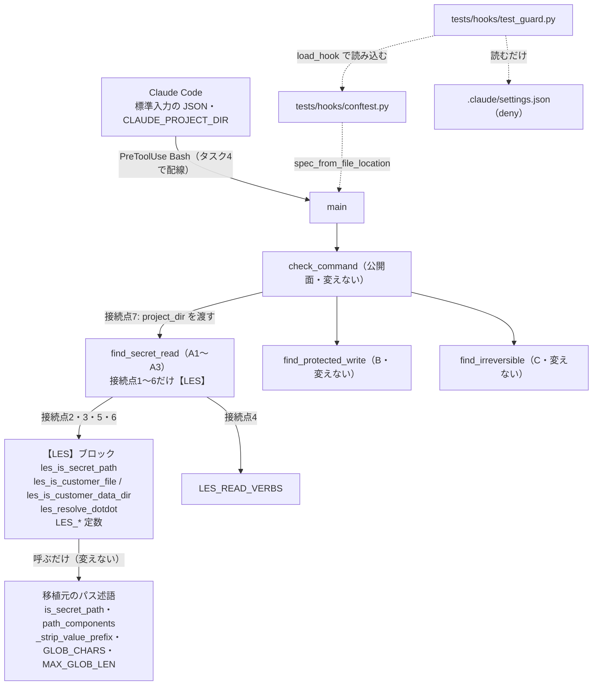

# 設計書: シェル経由の危険操作を止める PreToolUse フック（guard）を持ち込む

作成日: 2026-10-29（architect）
最終更新: 2026-11-01（architect。3e レビュー後の運営者の決定11＝途中に `..` を挟んだ `data/` を止める・決定12、モジュールの docstring の言い換えを反映。決定10 の記述を直した）
対象タスク: `tasks/todo.md`「実装計画: 開発基盤の安全設定」タスク3（3b）
振る舞い仕様（正本）: `docs/design/test_spec_guard_hook.md`（10節が LES の差分、11節が運営者の決定 2026-10-29・2026-10-30・2026-11-01）
移植元: 別リポジトリで導入済みの guard フック。**移植元のコミット `d20ea9a`**（本体・テスト・設計）
次工程: engineer（3c・3d）→ reviewer（3e）→ 配線（タスク4）

> 判定の仕組み（字句解析・包み込み・A/B/C の規則・性能・fail-open）は移植元の設計のとおりで、本書には書き直さない。本書に書くのは **LES の差分をどこに・どう置くか**と、持ち込みの手順だけ。

---

## 1. 目的

`.claude/settings.json` の `permissions.deny` は Read ツールにしか効かず、Bash の `cat .env`・`sqlite3 data/clients.db` は素通りする。移植元の guard（標準ライブラリだけの1ファイル）を LES に複製し、LES の差分（顧客データ・`.env.development` の例外・`sqlite3`/`unzip`）を足して、秘密・顧客データの読み取り／安全設定の書き換え／取り返しのつかない git・rm を Bash の実行前に止める。

もう1つの目的は **二重管理の手当て**（`tasks/todo.md`「guard の持ち込み方」案A の弱点）。移植元が今後 guard を直したとき、その修正を LES に機械的に写せるよう、LES の差分を見つけやすい1か所に閉じ込める。

計算モデル・`src/` には触れない。FP 確認事項は無い。

---

## 2. 対象ファイル（層ごと）

| 層 | ファイル | 変更 | 中身 |
|---|---|---|---|
| 開発基盤（フック） | `.claude/hooks/guard.py` | **新規** | 移植元のコミット `d20ea9a` の複製＋【LES】ブロック＋接続点7行（設計の要点1） |
| テスト | `tests/hooks/test_guard.py` | **新規** | 移植元のテストの複製＋仕様の【LES】の行（設計の要点3） |
| テスト | `tests/hooks/conftest.py` | 変更 | `_load` を `load_hook` に改名（公開する）。fixture 2つの本体はその呼び出しに変わるだけ |
| テスト | `tests/fixtures/deny_probe/.env` | **新規** | 中身 `DUMMY=1` の1行（仕様5節。タスク6の実機確認用） |
| 設定 | `.gitignore` | 変更 | `.env` 行の直後に `!tests/fixtures/deny_probe/.env` |
| 設定 | `pytest.ini` | 変更 | `slow` の説明に guard の性能テストを足す（決定4） |
| 文書 | `README.md` | 変更 | 「データの置き場所」に1文（決定6） |
| 文書 | `docs/rules/00_workflow.md` | 変更 | ディレクトリ構成図に `tests/fixtures/` を足す（「新しい置き場を作るときは、この構成図に足してから作る」）。最終更新日を変える |
| 設定 | `.claude/settings.json` | **変えない** | 配線はタスク4（設計の要点6） |
| ドメイン・入力・出力・API・DB | `src/` 全体 | 変更なし | — |

---

## 3. 設計の要点

### 1. 差分の置き方: 「移植元の関数は書き換えない。差分は【LES】ブロック1か所と、印の付いた接続点だけ」

#### 結論

`guard.py` を次の3種類の行だけで移植元と違える。

| 種類 | 置き場所 | 印 |
|---|---|---|
| **【LES】ブロック**（定数＋判定の関数4つ） | パス述語の節の末尾（`is_broad_target` の後ろ・「規則」の節の見出しの前）に1つだけ | ブロックの始まりと終わりの見出しコメント。定数は `LES_`、関数は `les_` で始める |
| **接続点**（既存の行の置き換え） | `find_secret_read` の中の6行＋`check_command` の1行（下の表） | 行末に `# 【LES】` |
| **docstring の書き換え** | モジュールの docstring（冒頭の複製の説明4行と、「なぜ必要か」の露出の文1行）・`_covers` の docstring（公開リポジトリに出せない例の置き換え） | 文中か行末に `【LES】` |

モジュールの docstring の「なぜ必要か」の行（移植元の14行目付近）は、移植元の事故の日付を書いている。LES のファイルで主語が無いと LES 自身の事故に読め、別プロジェクトの日付を公開することにもなるので、次のとおり言い換える（運営者決定 2026-11-01。仕様0節の書き方と同じ）。

```text
移植元:  Bash の `cat .env` は素通りする（<日付> に本物の .env が会話に露出した）。
LES:     Bash の `cat .env` は素通りする（移植元では、本物の .env の中身が会話に露出した）。【LES】
```

`<日付>` は本書に書かない（同じ理由）。行頭の字下げ（2文字）は移植元のまま。

これ以外の行（移植元の関数・定数・語彙表）は**一字一句変えない**。`is_secret_path`・`READ_VERBS`・`SAFE_ENV_SUFFIXES` も変えない。

#### 【LES】ブロックの中身（シグネチャと決めごと）

```python
# ===========================================================================
# 【LES】移植元のコミット d20ea9a からの差分（ここから）
#   移植元の関数・定数は書き換えない。差分はこのブロックと、行末に `# 【LES】` を付けた接続点だけ。
#   仕様: docs/design/test_spec_guard_hook.md 10節（L1〜L6・V）
# ===========================================================================

# V: 読み取り動詞に足す（9.3 の除外の値・9.4 の一覧だけには足さない。7節-21）
LES_READ_VERBS = frozenset({"sqlite3", "unzip"})
# L1〜L3: 顧客 DB・出力の Excel（小文字にした basename で比べる）
LES_CUSTOMER_FILE_ENDINGS = (".db", ".xlsx")
LES_CUSTOMER_FILE_INFIX = ".sqlite"
# L4: glob のリテラルの `.` より後ろがこれに一致しうれば顧客ファイル（sqlite… は代表の綴りで見る）
LES_CUSTOMER_GLOB_SAMPLES = ("db", "xlsx", "sqlite", "sqlite3")
# L5: 顧客データの置き場所（プロジェクト直下の data/ だけ）
LES_CUSTOMER_DATA_DIR = "data"
LES_PROJECT_DIR_VARS = ("$claude_project_dir", "${claude_project_dir}")  # 小文字にした後で比べる
# L5（決定11）: `..` を解くときに残す前置部分（小文字にした後で比べる。先頭の `/` は normpath が残す）
LES_PATH_ANCHORS = ("~", "$home", "${home}") + LES_PROJECT_DIR_VARS
# L6: basename がちょうどこれなら .env.* の規則から外す（.env.development.local は外さない）
LES_ENV_EXCEPTIONS = frozenset({".env.development"})


def les_is_customer_file(base: str) -> bool:
    """L1〜L4。base は小文字の basename"""

def les_resolve_dotdot(raw: str) -> str:
    """L5（決定11）。前置部分を残し、`.` と `名前/..` を打ち消した形。前置部分より前に戻らず、相対パスの先頭に余った `..` は残す"""

def les_is_customer_data_dir(word: str, project_dir: str | None, in_code: bool) -> bool:
    """L5。word は小文字。先頭側で判定する。書いたままの形と `..` を解いた形のどちらかで当たれば真。in_code（A3）では `/` を含まない語を数えない"""

def les_is_secret_path(word: str, project_dir: str | None = None, in_code: bool = False) -> bool:
    """移植元の is_secret_path に L1〜L6 を重ねる。A1〜A3 の秘密パスの判定はすべてここを通る"""

# 【LES】差分（ここまで）
```

| 関数 | 決めごと |
|---|---|
| `les_is_customer_file(base)` | ① `base` が `LES_CUSTOMER_FILE_ENDINGS` のどれかで終わるか、`LES_CUSTOMER_FILE_INFIX` を含めば真（L1〜L3）。② L4: `base` に `GLOB_CHARS` が無いか `MAX_GLOB_LEN` より長ければ偽。そうでなければ `base.rpartition(".")` で**最後の `.`** より後ろを取り、それを glob として `LES_CUSTOMER_GLOB_SAMPLES` のどれかに `fnmatch.fnmatchcase` で一致すれば真。`.` が無ければ偽（`*.xls?`・`clients.d?`・`*.*`・`*.s*` は真、`*`・`cf_*`・`*.py` は偽） |
| `les_resolve_dotdot(raw)` | 決定11の「`..` を解いた形」（仕様3.3）を作るだけ。`anchor, sep, rest = raw.partition("/")`。`sep` があり `anchor` が `LES_PATH_ANCHORS` のどれかなら `anchor + "/" + posixpath.normpath(rest)`、そうでなければ `posixpath.normpath(raw)`。絶対パスは `normpath` が先頭の `/` を残し、`/..` を `/` で止める。相対パスの先頭に余った `..` も `normpath` が残す（`src/../../data/x` → `../data/x`） |
| `les_is_customer_data_dir(word, project_dir, in_code)` | `in_code` で `/` を含まなければ偽（決定1）。`raw = _strip_value_prefix(word)`。調べる形の並び `forms` を作る: 書いたままの形 `(raw, path_components(word))`（今の判定のまま）と、`raw` に `..` があるときだけ解いた形 `(resolved, path_components(resolved))`（`resolved = les_resolve_dotdot(raw)`）。各形 `(form, comps)` に次を掛ける: ① `form` が `/`・`~`・`$` で始まらず `comps[0] == "data"` ② `comps[0]` が `LES_PROJECT_DIR_VARS` のどれかで `comps[1] == "data"` ③ `project_dir` があるとき、`posixpath.basename(posixpath.normpath(project_dir)).lower()` と等しい構成要素の直後が `"data"`。どれかの形でどれかに当たれば真（`comps` が空の形は飛ばす。③のフォルダ名はループの外で1回だけ作る） |
| `les_is_secret_path(word, project_dir, in_code)` | `w = word.lower()`、`comps = path_components(w)`。(1) `les_is_customer_file(comps[-1])` なら真 (2) `les_is_customer_data_dir(w, project_dir, in_code)` なら真 (3) `comps[-1]` が `LES_ENV_EXCEPTIONS` にあれば `is_secret_path(posixpath.dirname(_strip_value_prefix(word)))` を返す（basename の規則＝`.env.*` だけを外し、構成要素の規則＝退避フォルダは親のパスで移植元の判定に掛ける） (4) それ以外は `is_secret_path(word)` |

L6 を (3) の形にする理由: 「`.env.development` なら偽」と書くと、移植元が将来 `is_secret_path` に構成要素の規則を足したとき、LES 側でその規則まで打ち消してしまう。親のパスを移植元の判定に掛ければ、basename 以外の規則は移植元の変更に自動で追従する（`~/claude-settings-backup/.env.development` は止まる。仕様11節 決定10で確定し、`test_env_development_in_backup_dir_still_blocked` で固定済み）。

#### 決定11: `..` を解いた形の作り方と置き場所

**結論**: 正規化は【LES】ブロックの中の別関数 `les_resolve_dotdot` に分け、`les_is_customer_data_dir` の中で「書いたままの形」と「解いた形」の2つに①〜③を掛ける。前置部分（`~`・`$HOME`・`${HOME}`・`$CLAUDE_PROJECT_DIR`・`${CLAUDE_PROJECT_DIR}`。先頭の `/` は `normpath` が残す）を残す手当てを入れる。移植元の `path_components` は書き換えず、書いたままの形の判定にそのまま使う。

| 案 | 内容 | 評価 |
|---|---|---|
| **A. 正規化を別関数に分け、判定の中で2つの形に掛ける（採用）** | 上のとおり | 「解いた形を作る」（仕様3.3 の定義そのもの）と「①〜③を掛ける」が別の関数になり、どちらも1か所で読める。書いたままの形は今の `(raw, path_components(word))` をそのまま並びの1つ目に置くので、今の判定は1文字も変わらない。2つの形は OR で掛けるので、解いた形の側にどんな癖があっても**止める側にしか動かない**（仕様7節-23 の「止める側にだけ倒す」が構造で守られる） |
| B. 判定の中に正規化を書き込む（関数を足さない） | `les_is_customer_data_dir` の中で `normpath` と前置部分の手当てを直接書く | 関数は増えないが、①〜③と前置部分の手当てが1つの関数に混ざる。前置部分の手当てを読むのに①〜③を読み分ける必要がある |
| C. ①〜③を「1つの形に掛ける関数」に切り出し、2回呼ぶ | `les_matches_data_dir(form, comps, name)` を足す | B より読めるが、A のループ（2行）で済むものに関数を1つ足すことになる。重複は2回目だが、ループで消える重複なので抽象を足すほどではない |
| D. `path_components` を `..` を解く形に変える／解いた形だけで判定する | 移植元の関数を書き換える／書いたままの判定を捨てる | 移植元の関数を変えない原則（設計の要点1）に反する。解いた形だけにすると `cat data/../src/a.py`・`cat /work/proj/../data/x` が通るようになる（仕様7節-23 が禁じる） |

**前置部分を残す手当てを入れる理由**: `posixpath.normpath` だけだと `~/../data/x`・`$HOME/../data/x` が `data/x` になり、①（相対パスの最初が `data`）で止まる。止まりすぎで、仕様3.3 の「解いた形」の定義（前置部分より前には戻らない）とも違う。この形はテストで固定しない（仕様7節-23）が、定義どおりに作るのにかかるのは定数1つと2行なので入れる。`$CLAUDE_PROJECT_DIR` を前置部分に含めても含めなくても結果は変わらない（`$CLAUDE_PROJECT_DIR/../../data/x` は残せば②、残さなければ①で止まる）が、仕様3.3 の列挙にそろえて含める。

**`..` があるときだけ解いた形を作る理由**: `path_components` は `.` と空の構成要素を既に捨てているので、2つの形の構成要素が違うのは `..` があるときだけ。`..` の無い大多数の語で `normpath` を呼ばずに済む（秘密パスの判定は語ごとに走るので、語ごとの処理を増やさない）。名前に `..` を含む語（`a..b/data`）でも解いた形は書いたままと同じになるだけで、結果は変わらない。

**解いた形に `path_components` を掛ける**: 解いた形は `_strip_value_prefix` 済みの `raw` から作るので、`path_components(resolved)` は前置の `x=`・`@` を2回外しうる（`a=b=data/x` など）。書いたままの形は今の判定のまま残すので、2回外すことで変わるのは解いた形の側だけで、OR で掛けるので止める側にしか動かない。そのために専用の分割を書かない（移植元の関数の複製を作らない）。

**行数の見込み**: 【LES】ブロックに約 +16 行（定数とコメント 2行・`les_resolve_dotdot` 6行・空行2行・`les_is_customer_data_dir` の差分 +6行）。接続点7行・移植元の関数・定数・import は増えも変わりもしない（`posixpath` は移植元が既に import している）。

#### 接続点（移植元の行を置き換える7行）

| # | 場所 | 移植元 | LES |
|---|---|---|---|
| 1 | `find_secret_read` の定義 | `(cmds, command)` | `(cmds, command, project_dir: str \| None = None)` |
| 2 | A2（入力リダイレクト） | `is_secret_path(r.target)` | `les_is_secret_path(r.target, project_dir)` |
| 3 | A3（インラインコード） | `is_secret_path(token)` | `les_is_secret_path(token, project_dir, in_code=True)` |
| 4 | A1 の動詞 | `inv.name in READ_VERBS` | `inv.name in READ_VERBS or inv.name in LES_READ_VERBS` |
| 5 | A1 の語 | `is_secret_path(word)` | `les_is_secret_path(word, project_dir)` |
| 6 | A1 のリダイレクト | `is_secret_path(r.target)` | `les_is_secret_path(r.target, project_dir)` |
| 7 | `check_command` | `find_secret_read(cmds, command)` | `find_secret_read(cmds, command, project_dir)` |

`check_command`・`main` の公開面（仕様1節）は変えない。`project_dir` は `main` が `CLAUDE_PROJECT_DIR` から渡す既存の値をそのまま流すだけ。

#### 定数だけで済まない理由（`tasks/todo.md` 3c の前提の訂正）

`tasks/todo.md` 3c は「語彙表（定数）だけに LES の差分を足す」としていたが、仕様10.1 のとおり L4（glob の拡張子）・L5（先頭側で判定・`project_dir` 基準・A3 では `/` を含む語だけ）・L6（basename 完全一致の例外）は移植元の判定の形に乗らない。移植元の `is_secret_path` は `project_dir` も「A3 から呼ばれたか」も受け取らないので、**判定の関数の追加と、`project_dir`・`in_code` を渡す接続点が要る**。それを「1ブロック＋印の付いた7行」に閉じ込めるのが本設計。

#### 比べた案

| 案 | 内容 | 評価 |
|---|---|---|
| **A. ブロック1つ＋接続点に印（採用）** | 上のとおり | 移植元の関数が一字一句残るので、移植元の修正の差分（`git diff d20ea9a <新>`）は接続点の7行に触れない限りそのまま当たる。差分の全体は `【LES】`・`LES_`・`les_` の検索で見つかる。`project_dir` の渡し方が引数で見える（純粋関数のまま） |
| B. `is_secret_path` などを直接書き換える | 引数を足し、中に L1〜L6 の分岐を足す | 行数は最小だが、移植元が `is_secret_path` を直すたびに衝突する。差分が関数の途中に散る |
| C. 差分を定数に寄せ、汎用の「追加規則表」を移植元側に作る | `EXTRA_SECRET_RULES = [関数…]` を移植元にも入れる | 移植元にとっては使わない仕組み（拡張より削除に強い設計に反する）。2プロジェクトのために抽象を足すのは過剰 |
| D. 別ファイル（`guard_les.py`）に差分を置いて import | guard.py は移植元と完全一致 | import は `main()` の `try` の外で走り、壊れると Bash 全体が止まる（fail-open に反する）。`.claude/hooks/` の「1フック = 1ファイル」（`docs/design/edit_hooks.md` 設計の要点2）にも反する |
| E. 判定の結果を `check_command` の後で LES 側から上書き | 接続点は1か所 | A1 の「動詞と秘密名がコマンド全体で同居」・9.3/9.4 の割り引きの位置をやり直すことになり、移植元の規則を二重に持つ |

### 2. 依存の方向



- 【LES】ブロックは移植元のパス述語だけを使い、規則（`find_*`）を呼ばない。規則の側から【LES】ブロックを呼ぶ一方向
- 【LES】ブロックはパス述語の節の末尾に置くので、ブロックが使う名前はすべてブロックより上で定義済み。ブロックを使う接続点はすべてブロックより下
- 標準ライブラリだけ（`fnmatch`・`posixpath` は移植元が既に import している。import の行は変えない）

### 3. テストの置き方

#### 読み込み: conftest の `load_hook` を使い、モジュールの中の `_hook()` 1か所で受ける

| 案 | 評価 |
|---|---|
| **A. `tests/hooks/conftest.py` の `_load` を `load_hook` として公開し、`test_guard.py` の `_hook()` を `functools.cache` 付きでそれを呼ぶ関数にする（採用）** | 移植元のテストは本体へのアクセスがすべて `_hook()` を通る作りなので、置き換えは読み込みの数行だけで済む（数百のテスト・ヘルパーは変えない）。スクリプトが無いときは `hook_script` が**テストごとに** `pytest.fail` する（`_hook()` は最上位で呼ばない）。`sys.modules` に登録しない LES の流儀にそろう（guard は NamedTuple なので登録が無くても動く。試作で確認） |
| B. conftest に fixture `guard_hook` を足し、各テストが受け取る | タスク2のフックと同じ形だが、ヘルパー（`assert_blocked`・`run_main`）がモジュールの関数なので fixture を渡せない。全メソッドの引数を変えることになり、移植元のテストとの差分が全行に広がる |
| C. 移植元どおりモジュールの読み込み時に `spec_from_file_location` する | 差分は最小だが、LES の conftest と読み込みの書き方が2通りになる（仕様2節「conftest にそろえる」に反する） |

`test_guard.py` の先頭で変える行（すべて `# 【LES】`）:

```python
from tests.hooks.conftest import hook_script, load_hook  # 【LES】

REPO_ROOT = Path(__file__).resolve().parents[2]           # 変えない（SETTINGS_PATH に使う）
SETTINGS_PATH = REPO_ROOT / ".claude" / "settings.json"   # 変えない
# HOOK_PATH・EXPECTED_COMMAND・_load_hook・hook は持ち込まない  # 【LES】

@functools.cache
def _hook():  # 【LES】無ければ hook_script が pytest.fail（テストごと）。例外は cache されない
    return load_hook("guard")
```

- `run_subprocess` の `[sys.executable, str(HOOK_PATH)]` は `[sys.executable, str(hook_script("guard"))]` にする（`# 【LES】`）。`env`・`cwd`（`tmp_path`）は仕様4節のまま
- `test_never_opens_files` は `_hook()` を `open` の差し替えより前に呼ぶ（移植元の書き方のまま。初回の読み込みを差し替えの中でしない）
- ヘルパー（`assert_blocked`・`assert_allowed`・`params`・`with_body`・`run_main`・`FUNCTION_AND_COPROC_FORMS` など）は移植元どおり**モジュールの中に閉じる**（conftest に移さない。移すと移植元との差分が広がり、他のフックのテストと関係が無い）

#### 移植元のテストへの【LES】の当て方

| 当てるもの | 書き方 |
|---|---|
| パラメータの置き換え（仕様4節・9節の【LES】の行。パスの例・日常コマンド） | 置き換えた行の行末に `# 【LES】` |
| 移したパラメータ（`cat .env.development` を止める側から外す、9.2.1 の実際の形を `/work/proj`・`[.]sqlite` の形に替える等） | 元の場所に `# 【LES】<何を・どこへ・なぜ>` の1行を残す（消した理由が移植元との diff で読める） |
| 持ち込まないテスト（`test_settings_wires_guard`。タスク4で LES の形で書く） | 元の場所に `# 【LES】test_settings_wires_guard はタスク4（配線）で書く` |
| LES で足すメソッド（仕様10.2・10.3、4節の【LES】のメソッド） | 仕様が指定するクラス（`TestSecretRead`・`TestEverydayCommandsAllowed`・`TestMainContract`・`TestRepositoryIntegration`）の**末尾**に、`# --- 【LES】ここから（仕様 10.2・10.3）---` と `# --- 【LES】ここまで ---` で囲んで置く |
| 性能テスト2メソッドの `slow`（決定4） | `@pytest.mark.slow  # 【LES】`。他のメソッドには付けない |
| `DENY_SAMPLES`（3d） | 移植元と同じ位置（`TestRepositoryIntegration` の前）。16件を仕様4節の表の順で書き、移植元から変えた行に `# 【LES】` |

LES のテストを別ファイル（`test_guard_les.py`）にする案は採らない。仕様がメソッドの置き場所をクラスで指定しており（ノード ID が `TestSecretRead::test_customer_…` になる）、別ファイルからヘルパーを import するとテストモジュール同士の依存ができるため。クラス末尾の囲みは、移植元のテストの修正を写すときに衝突しても位置で解ける。

### 4. 置くファイルと中身（3c・3d）

| 項目 | ファイル | 中身 |
|---|---|---|
| 3d deny との一致 | `tests/hooks/test_guard.py` の `DENY_SAMPLES`・`TestRepositoryIntegration` | `DENY_SAMPLES` は仕様4節の16件。`test_every_read_deny_is_covered` は `check_command(f"cat {sample}", str(REPO_ROOT))`（`project_dir` を渡す。`# 【LES】`）。`test_deny_exception_is_also_allowed_by_guard` を【LES】の囲みに足す |
| 3c fixture | `tests/fixtures/deny_probe/.env` | `DUMMY=1` の1行。**Write ツール**で作る（仕様5節） |
| 3c fixture の除外 | `.gitignore` | `.env` 行（「# 環境変数」の節）の**直後**に `!tests/fixtures/deny_probe/.env` と、その上に理由のコメント1行（「guard・deny の実機確認用のダミー。中身は DUMMY=1」）。受け入れ基準は仕様5節（`git check-ignore` の3点） |
| 3c `slow` | `pytest.ini` | `slow: 時間のかかるテスト（WeasyPrint を実際に呼び出すテスト・guard の性能テスト）。通常の CI では -m "not slow" で除外可` |
| 3c README | `README.md`「データの置き場所」 | 表の直後（「コマンドは**リポジトリ直下で実行**します。」の前）に1文: 「`data/scenarios/` などに置くファイルの名前に、顧客の名前を使わないでください（ファイル名は `ls` などで会話や画面に出るため）。」表・既存の文は変えない |
| 3c 構成図 | `docs/rules/00_workflow.md` | `tests/` の下に `fixtures/  ← テストが使うダミーのファイル（deny_probe/.env: guard・deny の実機確認用）` を足す |

### 5. `.claude/` を誰がどう書くか

- **`.claude/hooks/guard.py` は engineer が Write ツール・Edit ツールで書く**（`Edit(./.claude/hooks/**)` の ask で承認ダイアログが出る。人が承認する）。Write・Edit のたびにダイアログが出ることを確かめ、出なければ作業を止めて運営者に報告する（ask が効いていないことになり、タスク6の確認項目にも当たる）
  - **2026-11-01 追記: 3c の Write・Edit では承認ダイアログが出なかった**（人の承認はコミット前の差分の確認で代えた）。別のプロジェクトのセッションから書いたため LES の ask が当たらなかった可能性と、セッションの権限モードが ask を自動で通した可能性があり、切り分け中。**LES の `.claude/settings*.json`・`.claude/hooks/**` は LES のセッションで、ダイアログが出ることを確かめてから書く。出なければ書く前の差分を人に見せて承認をもらう**
- **`/tmp`・scratchpad などで作ったものを `cp`・`rsync`・リダイレクト・`patch` で写す手順は取らない**。理由: ①承認ダイアログという人の確認を飛ばす ②試作とレビューしたものがずれる ③移植元の guard が動いているセッションでは、他のプロジェクトの `.claude/hooks/` への Bash の書き込みは止まる（仕様9.5）。止められたら回避せず報告する ④`cp -r /tmp/p/. <プロジェクト>` は guard の既知の穴（仕様8節）で、手順として使うと穴を常用することになる
- 1,400行を超えるファイルの承認ダイアログは人が読み切れないので、**2段に分けて書く**:
  1. Write ツールで、移植元のコミット `d20ea9a` の `guard.py` と**一字一句同じ**ものを書く。`cmp <移植元の guard.py> .claude/hooks/guard.py` で一致を確かめる（読むだけのコマンド）。移植元の `guard.py` が `d20ea9a` から変わっていないことも移植元の側で確かめる（`git diff --quiet d20ea9a -- .claude/hooks/guard.py`）
  2. Edit ツールで、【LES】ブロック・接続点7行・docstring を**小さな Edit に分けて**当てる。ダイアログに出る差分が数行〜数十行になり、人が読める
- `tests/hooks/test_guard.py`・`tests/fixtures/deny_probe/.env` も Write・Edit ツールで書く（`.claude/` の外なので承認の対象ではないが、手順をそろえる。fixture は仕様5節のとおり Write ツール）

### 6. 配線（タスク4）への引き継ぎ

- 形は仕様6節のとおり: `{"matcher": "Bash", "hooks": [{"type": "command", "command": "python3 \"$CLAUDE_PROJECT_DIR\"/.claude/hooks/guard.py", "timeout": 10}]}`。`docs/design/edit_hooks.md` 設計の要点6の例の guard の行には `timeout` が無いが、guard の行は本書（＝`"timeout": 10`）に合わせる。`PreToolUse` の中のグループの順は問わない
- 同じ工程で `docs/design/edit_hooks.md` 設計の要点6のとおり2フックも差し替え、`test_settings_wires_guard`（仕様4節。3キーだけ比べる）と G1〜G4 を `tests/hooks/` に書く。移植元の `test_settings_wires_guard` が見ている別名のフック（移植元にだけある Edit|Write のフック）は持ち込まず、LES の `pre_tool_fp_warning.py`・`post_tool_run_tests.py` を見る
- **配線は Edit ツール（承認あり）で行う**。配線した瞬間から、LES の Bash で `.claude/settings*.json`・`.claude/hooks/**` を書き換えられなくなる。以後の guard.py・settings.json の修正（移植元の修正を写すときも）は Edit ツールだけ。誤検知で作業が止まったときの外し方も Edit ツール（Bash では外せない）
- 配線後は LES のセッションで次が止まる（仕様8節の止まりすぎ）。逃げ道は Grep ツール・テストに書くこと: `grep -rn data src/`・`grep -rn "src.db" src/`・`python3 -c "import src.db"`・`.venv/bin/python -m src.main data/scenarios/a.yaml | tail -3`・`find data -name '*.yaml' | sort`。加えて、A1 は動詞と秘密名をコマンド全体で見るので、`mkdir -p data/scenarios && cat README.md` のように `data` と読み取り動詞が1行に同居すると止まる（7節-2・19 のとおり）
- hooks の設定はセッションの起動時に読まれる。効かせるには Claude Code の再起動が要る（タスク6はその後）
- タスク6の結果は本書の末尾「実機確認の結果」に書く

---

## 4. テスト設計（アクセプタンス基準との対応）

テストクラス・メソッドは仕様4節・10節をそのまま使う。

| 仕様 | 主に効く設計の部品 |
|---|---|
| 4節 `TestSecretRead`（移植元の分） | 移植元の判定（変えない）。`les_is_secret_path` の (4) が `is_secret_path` に落ちること |
| 10.2 L1〜L3・`test_customer_db_and_excel_then_blocked`・`test_customer_files_under_tmp_still_blocked` | `les_is_customer_file` の①（前置部分を問わない） |
| 10.2 L4・`test_glob_*` | `les_is_customer_file` の② |
| 10.2 L5・`test_customer_data_dir_*`・`test_other_data_dirs_and_similar_names_then_allowed`・`TestMainContract.test_project_dir_from_environ_for_customer_data` | `les_is_customer_data_dir`、接続点1・7（`project_dir` の流れ） |
| 10.2 決定11・`test_customer_data_dir_through_dotdot_then_blocked`・`test_customer_data_dir_without_project_dir_then_blocked` の決定11の2行 | `les_resolve_dotdot` と、`les_is_customer_data_dir` の解いた形の側 |
| 10.2 決定11・`test_customer_data_dir_written_form_still_blocked` | `les_is_customer_data_dir` の書いたままの形の側（今の判定を残すことの回帰防止） |
| 10.2 決定11・`test_dotdot_not_resolving_to_customer_data_then_allowed` | 2つの形のどちらでも①〜③に当たらないこと（`project_dir` が `/work/proj` と None の両方） |
| 10.2 決定1・`test_interpreter_inline_code_*` | 接続点3の `in_code=True` |
| 10.2 L6・`test_env_development_*`（決定10の `test_env_development_in_backup_dir_still_blocked` を含む）・4節 `test_deny_exception_is_also_allowed_by_guard` | `les_is_secret_path` の (3) |
| 10.2 V・`test_sqlite3_and_unzip_*` | 接続点4・`LES_READ_VERBS` |
| 10.3（9節との組み合わせ） | 移植元の割り引き（9.3・9.4）が `les_is_secret_path` の前に語を外すこと。`LES_READ_VERBS` を 9.3・9.4 の表に入れないこと |
| 4節 `test_never_opens_files`（【LES】の行） | 【LES】ブロックが `fnmatch`・`posixpath` の文字列処理だけであること |
| 9.7・5節 `slow` | 性能テストの2メソッドだけに `@pytest.mark.slow` |

**Red → Green の順**

1. Red-1: `conftest.py` の改名、`test_guard.py`・fixture・`.gitignore` を書く。guard.py が無いので、guard のテストが**テストごとに**「フックのスクリプトが無い」で落ちる（収集エラーにならない）。タスク2のテストは通ったまま
2. Red-2: guard.py を移植元と一字一句同じに書く（設計の要点5の1）。移植元由来のテストが通り、**【LES】のテストだけが落ちる**ことを確かめる（LES の差分の Red）。2026-10-29 に architect が移植元の判定に移植元のテストを当てて試したとき、落ちるのは仕様が LES で変えた2件（`test_secret_env_variants_then_blocked` の `.env.development`・9.2.1 の形）だけだった。LES のテストはそれらを置き換えた形で持つので、Red-2 で落ちるのは【LES】の行・囲みのテストだけになるはず
3. Green: Edit ツールで【LES】ブロック → 接続点7行 → docstring。全件緑（`.venv/bin/python -m pytest tests/hooks/ -q`）、`-m "not slow"` で性能テスト2件が deselected、`-m slow` で2件だけ走る
4. 付随: `pytest.ini`・README・`docs/rules/00_workflow.md`
5. reviewer（3e）

**試作での確認（2026-10-29・architect）**: scratchpad で移植元の guard に本書の【LES】ブロックと接続点を当て、仕様10.2・10.3・4節の【LES】の行（194件。`DENY_SAMPLES` の16件を含む）がすべて仕様どおりに止／通になること、移植元のテスト（性能テストを含む）が上の2件を除いて通ることを確かめた。試作は持ち込まない（engineer が本書から書く）。

**決定11の工程（2026-11-01 の追加分）**

1. Red: 仕様10.2 の決定11の3メソッド（`test_customer_data_dir_through_dotdot_then_blocked`・`test_customer_data_dir_written_form_still_blocked`・`test_dotdot_not_resolving_to_customer_data_then_allowed`）と、`test_customer_data_dir_without_project_dir_then_blocked` の2行を、`TestSecretRead` の【LES】の囲みに足す。落ちるのは `through_dotdot` の17行と `without_project_dir` の2行だけで、`written_form_still`・`not_resolving` は今の guard で通る（下の試作と同じ結果になるはず）
2. Green: Edit ツールで【LES】ブロックに `LES_PATH_ANCHORS`・`les_resolve_dotdot` を足し、`les_is_customer_data_dir` を2つの形に掛ける形に直す。同じ工程でモジュールの docstring の「なぜ必要か」の1行を言い換える（設計の要点1）
3. 全件緑（`.venv/bin/python -m pytest tests/hooks/ -q`。性能テストを含む）→ reviewer

**試作での確認（2026-11-01・architect）**: scratchpad に LES の今の `guard.py` を写して読み込み、`les_is_customer_data_dir` を本書の形に差し替えた（`LES_PATH_ANCHORS`・`les_resolve_dotdot` を足した）うえで、仕様10.2 の決定11の行（3メソッドと `without_project_dir` の6行、`not_resolving` は `project_dir` の2通り）と決定10の2行、計51件を `check_command` に渡した。今の guard は19件が外れ（`through_dotdot` の17件と `without_project_dir` の決定11の2件が通ってしまう）、差し替え後は外れ0件。あわせて LES の `tests/hooks/test_guard.py` の全件（性能テストを含む）を差し替え後の guard に当て、1048件が通り、xfail 2件は従来どおりだった。参考（テストで固定しない形）: `cat ~/../data/x`・`cat $HOME/../data/x`・`cat ${HOME}/../../data/x`・`cat /../data/x` は通り、`cat $CLAUDE_PROJECT_DIR/../../data/x` は止まる（前置部分を残す手当てのとおり）。

---

## 5. 移植元の修正を写す手順（今後）

1. 移植元の側で `git diff d20ea9a <新しいコミット> -- .claude/hooks/guard.py tests/hooks/test_guard.py` を取る
2. 接続点（`# 【LES】` の行）・【LES】の囲みに触れない塊は、そのまま **Edit ツールで**当てる（配線後は Bash の `patch` は guard が止める）。触れる塊は、移植元の意図を読んで接続点を付け直す
3. `guard.py` の docstring と本書の「移植元のコミット」を新しいコミットに直す
4. 確かめ方（reviewer も同じ）: `diff <移植元の guard.py> .claude/hooks/guard.py` の差分が「【LES】ブロック・`# 【LES】` の行・`【LES】` を含む docstring の行」だけであること。移植元側の行（`<`）は接続点7行と docstring の行だけ。テストも同じ（`【LES】` の行と囲みだけ）
5. 移植元の仕様・テストに足された規則は、LES の仕様（`test_spec_guard_hook.md`）にも tester が写す

---

## 6. 採らなかった案

1. 差分を語彙表（定数）だけにする（`tasks/todo.md` 3c の元の書き方）: L4〜L6 が書けない（設計の要点1）
2. `SAFE_ENV_SUFFIXES` に `development` を足す: `.env.development.local` まで通る（仕様7節-17）
3. `is_secret_path` に `project_dir` を足して中で分岐する: 移植元の関数を書き換えることになり、移植元の修正と衝突する（設計の要点1 案B）
4. LES の差分を別モジュールにする: fail-open と「1フック = 1ファイル」に反する（同 案D）
5. テストを fixture 方式に直す: 移植元のテストとの差分が全メソッドに広がる（設計の要点3 案B）
6. `/tmp` で作った guard.py を `cp` で写す: 人の確認を飛ばす（設計の要点5）
7. 決定11で `path_components` を `..` を解く形に変える・解いた形だけで判定する: 移植元の関数を書き換え、書いたままの形で止まっていたもの（`cat data/../src/a.py` など）が通るようになる（設計の要点1「決定11」案D）
8. 決定11で `posixpath.normpath` だけを使う（前置部分を残さない）: `~/../data/x` を `data/x` と読み、仕様3.3 の定義から外れる（同 前置部分を残す手当て）

---

## 7. engineer へのノート

- **本物の `.env`・`frontend/.env.development`・`.claude/settings.local.json`・`data/` 配下・`*.db`・`*.xlsx` を開かない・cat しない**。fixture の `.env` も Write で作るだけで、読み返さない（中身の確認は `git diff --cached --stat` と運営者の目視。仕様5節）
- 移植元の行は一字一句変えない。迷ったら【LES】ブロックの中で解決する。接続点を7行より増やす必要が出たら、作業を止めて architect に戻す
- `les_is_secret_path` は**小文字にした語**で L1〜L5 を見る（仕様: 大文字小文字を区別しない）。`is_secret_path` には**元の語**を渡す（移植元が中で小文字にする）
- L5 ①の「相対パス」は `_strip_value_prefix` 後の語が `/`・`~`・`$` で始まらないこと（`/data/x`・`~/data/x`・`$HOME/data` は①に当たらない）。解いた形の側も同じ判定をその形の文字列に掛ける（`les_resolve_dotdot` は前置部分を残すので、相対か否かは書いたままの形と変わらない）
- 決定11: 書いたままの形の判定（`(raw, path_components(word))`）は今の行のまま並びの1つ目に置き、書き換えない。解いた形は**足すだけ**で、2つの形を OR で掛ける（どちらか一方でも当たれば真）。`..` を解くのは L5 だけ。`les_is_secret_path`・`les_is_customer_file`・L6 の (3) には解いた形を渡さない（仕様10.1「L5 と `..`」）
- `les_resolve_dotdot` は `posixpath.normpath` だけを使う（シンボリックリンクを解かない。`os.path.realpath`・`abspath` を使わない＝cwd を見ない）
- L4 は**最後の** `.` より後ろだけを見ればよい（見本の拡張子は `.` を含まず、`*`・`?` は `.` をまたいで一致させても見本には `.` が無いので、前の `.` から見た後ろが一致することはない）。`MAX_GLOB_LEN` を超える語は fnmatch に渡さない（移植元と同じ理由）
- 【LES】ブロックの関数で `open`・`os.path.expanduser`・`realpath` を使わない。`posixpath.normpath`・`basename`・`dirname` は文字列だけなので可
- 公開リポジトリに出せない語（移植元のリポジトリ名・チャンネル名・キャラクター名・ユーザー名・ホームのパス `/home/<名前>`）を `guard.py`・`test_guard.py`・コメントに残さない。移植元の `guard.py` には `_covers` の docstring にホームのパスの例があるので、`/home/user` に置き換えて `【LES】` を付ける。移植元のテストには移植元・LES の実パスやプロジェクト固有のコマンドがあるが、仕様4節・9節の【LES】の行で置き換え済み。仕上げに、依頼文で渡す語の一覧で grep して0件を確かめる（語の一覧は本書に書かない）
- モジュールの docstring に次を足す（`【LES】` 付き）: 移植元のコミット `d20ea9a` から複製したこと／LES の差分は `【LES】` で検索できること／A に顧客データ（`data/`・`*.db`・`*.sqlite*`・`*.xlsx`）を含めること
- モジュールの docstring の「なぜ必要か」の行は、移植元の事故の日付を外して「（移植元では、本物の .env の中身が会話に露出した）」に言い換え、行末に `【LES】` を付ける（設計の要点1。運営者決定 2026-11-01）。言い換えた後、guard.py に移植元の日付・事故の記述が残っていないことを確かめる
- 完了時に `docs/rules/00_workflow.md` の構成図を更新する（設計の要点4）

---

## 8. 仕様への指摘・運営者の判断が要る点

1. **退避フォルダの下の `.env.development`（3.3 の行どうしの重なり）**: 【解決済み】仕様11節 決定10（2026-10-30）で**止める**と決まり、3e で reviewer が `test_env_development_in_backup_dir_still_blocked`（10.2）で固定した。本設計の L6 の (3)（basename の規則だけを外す。設計の要点1）がそれを満たす。なお移植元では `~/claude-settings-backup/.env.example` が**通る**（`is_secret_path` が `.env.*` の行で先に返るため、3.3 の退避の行と食い違う）。LES では直さない（移植元の判定を変えない）。推奨: 移植元のバックログに記録し、移植元で直したら LES に写す
2. **`tests/fixtures/` は新しい置き場**: 仕様に構成図の更新は書かれていないが、`docs/rules/00_workflow.md`「配置の原則」により構成図に足す（設計の要点4に入れた）
3. **`tests/hooks/test_guard.py` のコメントに残る移植元の日付（2026-11-01・運営者の判断待ち）**: docstring の言い換え（設計の要点1）と同じ原因で、移植元のテストのコメントに主語の無い移植元の日付が5か所ある（「既知の穴（<日付> 運営者決定で今回は直さない）」・C1b・C2d の追加日・`restore`・`branch -D` の判断日）。事故の記述ではないが、「運営者決定」の1か所は LES の運営者の決定に読める。推奨: 同じ工程で5か所とも日付を「移植元で決定」などに言い換え、行末に `# 【LES】` を付ける（テストのコメントだけで判定に関係しない。移植元のテストとの差分は5行増える）。運営者が残すと決めた場合は、本項を「残す」に直す

---

## 実機確認の結果

（タスク6で書く）
